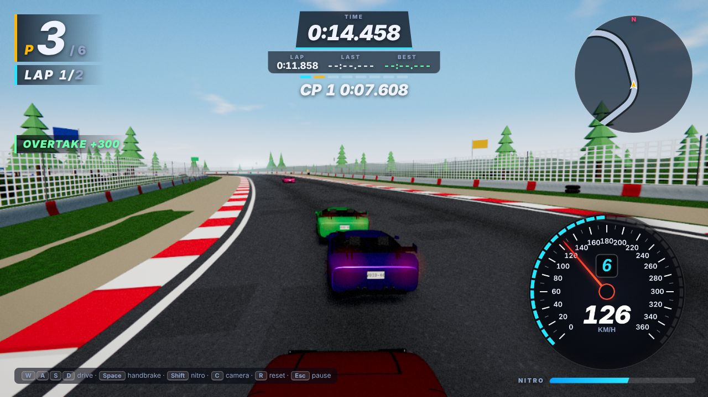
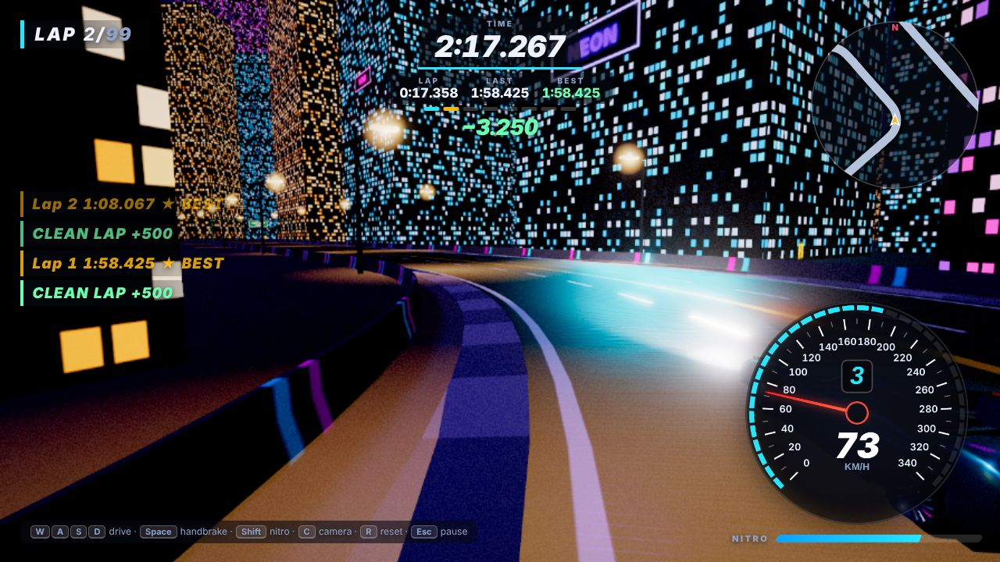
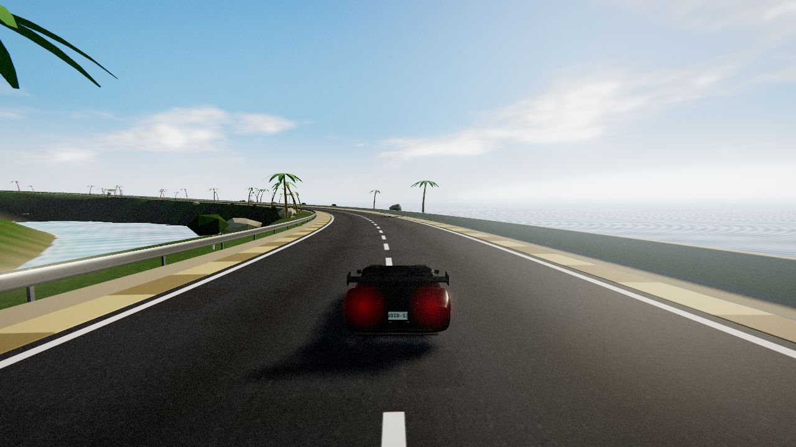
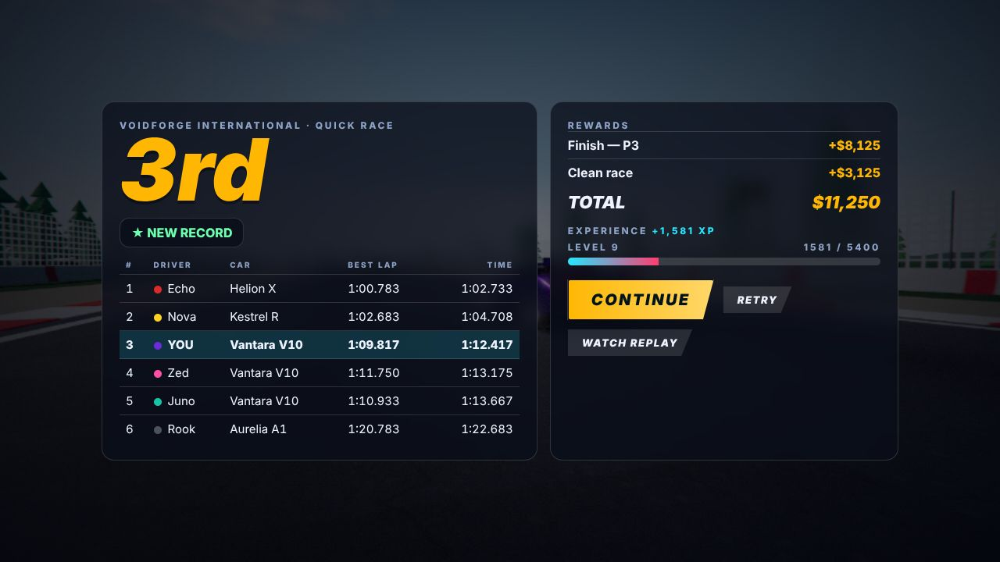

# Voidforge Racing

A premium-feeling **3D arcade racing game that runs entirely in the browser**. The whole game ships as **one static file** (`index.html`, ~860 KB, three.js bundled in): no server, no downloads, no external assets, original cars, tracks and audio.



| Neon District | Coastal Highway | Results |
| --- | --- | --- |
|  |  |  |

## Play it

Open `index.html` in a modern browser (Chrome, Edge, Firefox, Safari), or host the file anywhere static. Click once to enable sound. Drive!

```bash
npm install          # only needed to rebuild or run the tests
npm run build        # bundles src/ -> index.html
npm run dev          # rebuild on every change
```

URL shortcuts (handy for testing): `?unlockall` (all cars/tracks), `?autostart=race|trial|free|drift&track=neon&car=helion&laps=2&autopilot`.

## Controls

| Action | Keyboard | Gamepad | Touch |
| --- | --- | --- | --- |
| Accelerate / brake & reverse | `W` `S` / `↑` `↓` | RT / LT | GAS / BRAKE |
| Steer | `A` `D` / `←` `→` | Left stick | ◀ ▶ (or tilt, in Settings) |
| Handbrake (drift) | `Space` | X | DRIFT |
| Nitro | `Shift` | RB | NITRO |
| Camera (5 views) | `C` | Y | ⟳ |
| Reset to track | `R` | LB | – |
| Pause / mute | `Esc` or `P` / `M` | Start | ❚❚ |

## What's in it

**Game modes** – all fully playable:
- **Quick Race**: 1–8 laps against 3–7 AI rivals, four difficulty levels, checkpoint gates, positions, overtakes and clean-lap bonuses.
- **Time Trial**: unlimited laps, 8 splits compared against your best lap, a **ghost car** of your personal best, track records.
- **Free Drive**: explore any environment without rules.
- **Drift Challenge**: 2:30 score attack with chain multipliers, banking, bronze/silver/gold medals per track.
- **Championship**: three cups (Rookie → Pro → Apex), points standings, car and credit rewards, unlocks.

**Progression** (saved in `localStorage`): credits, XP and levels, six cars to buy/unlock, tracks that unlock by level, per-track records and ghosts, paint/finish, wheel design/colour and five upgrade categories (3 levels each) per car.

**Cars** (six original designs, each with distinct power, grip, balance and sound): Aurelia A1 (sports coupe), Brawler GT (muscle), Vantara V10 (supercar), Ridgeback RX (turbo AWD rally), Kestrel R (track car), Helion X (hypercar).

**Environments** (five, each with its own lighting, scenery, road surface and gameplay): Voidforge International (professional circuit with grandstands, pit complex, footbridge, catch fencing and tyre walls), Azure Coast Highway (ocean, cliffs, palms, tunnel through the headland), Neon District (night, wet asphalt, skyscrapers, neon signs, an underpass beneath a tower), Skyline Pass (100 m climb, switchbacks, pines, snow-capped peaks, a ridge tunnel) and Redrock Canyon Run (canyon walls, cacti, power lines, high-speed sweepers).

**Graphics**: lofted procedural car bodies with glass, interiors, wheels/calipers, lights and aero; PBR clearcoat paint with environment reflections generated from each sky; shader sky with volumetric-style clouds, stars and sun; soft shadows; MSAA; bloom; speed-sensitive radial blur and chromatic aberration; colour grading per environment; tunnel light adaptation; skid marks, tyre smoke, dust, sparks, nitro flames and speed streaks; dynamic headlights, brake lights, indicators.

**Physics**: fixed 120 Hz step; single-track tyre model with load sensitivity, longitudinal weight transfer, friction ellipse, electronic brake distribution, RPM/gearbox/turbo/rev limiter, aero drag + downforce, surface grip (asphalt, wet, kerb, gravel, grass, sand, dirt), banked and sloped roads, suspension roll/pitch/heave with independent wheel travel, rotational barrier and car-to-car collisions with cosmetic dents, and a drift stabiliser so slides stay controllable.

**Cameras**: spring chase, close chase, hood, cockpit (animated steering wheel and gauges), and a cinematic TV-style camera (also used for race-intro fly-overs and the replay).

**Audio** (all synthesised, no files): per-engine-type voices driven by RPM/load, turbo whine and blow-off, backfires, gearshifts, tyre squeal, road/wind/kerb rumble, tunnel reverb, impacts, UI sounds, countdown, procedural menu/race music and win/lose jingles. Separate master/music/effects/engine volume.

## Graphics presets and performance

| Preset | Resolution cap | Shadows | Post FX | MSAA | Scenery density |
| --- | --- | --- | --- | --- | --- |
| Low | 1.0× | off | none | – | 35 % |
| Medium | 1.25× | 1024 | bloom + blur | – | 70 % |
| High | 1.6× | 2048 | bloom + blur | 4× | 100 % |
| Ultra | 2.0× | 4096 | bloom + blur | 4× | 130 % |

Scenery is instanced, grouped into spatial cells, frustum-culled and LOD-switched; a **dynamic resolution governor** lowers/raises the render scale to hold ~55 fps. Typical High-preset cost: 300–1000 draw calls and 250–560 k triangles. Everything is disposed when a track unloads (verified: GPU geometry count stays flat across repeated loads).

## Hosting and embedding (Google Sites)

The game has **no server-side parts**. Host `index.html` on any static HTTPS host (GitHub Pages, Netlify, Cloudflare Pages, Google Cloud Storage/Firebase Hosting, …).

**GitHub Pages**: push the repo, then *Settings → Pages → Deploy from branch* (root). The game is at `https://<user>.github.io/<repo>/`.

**Google Sites**: *Insert → Embed → By URL*, paste the HTTPS URL of the hosted page, then resize the box. Or use *Embed code* and paste the snippet from [`docs/embed-example.html`](docs/embed-example.html) (a responsive 16:9 iframe). Tips:
- The iframe needs `allow="autoplay; fullscreen; gamepad; accelerometer; gyroscope"`. The snippet includes it.
- Sound starts after the first click or key press (browser rule); pointer lock is never used.
- Click the game once so it has keyboard focus. The game pauses automatically when the tab/iframe loses focus; use **Settings → Game → Fullscreen** for the best experience.
- All assets are inlined: no CORS, path or CDN issues. Progress is stored in the iframe origin's `localStorage` (private/blocked storage falls back to memory).

## Project layout

```
index.html            built game (committed so it can be hosted as-is)
build.mjs             esbuild bundler -> index.html
src/
  tracks.js           track layouts (corner/arc generator) + environment themes
  trackmath.js        spline sampling, elevation, banking, tunnels, spatial queries (pure, Node-safe)
  terrain.js          noise terrain blended around the road corridor, sea/canyon/mound features
  trackmesh.js        road, kerbs, barriers, fences, tunnels, gantries, chevrons, grid
  scenery.js          instanced/LOD scenery and per-environment set pieces
  sky.js              sky dome, clouds, environment maps, ocean, lighting rig
  carshapes.js cars.js carmodel.js   car data, stats/upgrades, procedural car builder
  vehicle.js          vehicle dynamics and collisions     ai.js   AI drivers
  game.js             session/race rules, modes, replay, effects, audio wiring
  camera.js post.js fx.js hud.js garage.js ui.js audio.js save.js input.js main.js
scripts/              validators, simulations and the browser smoke test
```

### Tests and tools

```bash
npm test             # track validation + vehicle dynamics + headless AI race simulation (Node only)
npm run smoke        # end-to-end in headless Chromium (needs Playwright): every mode, results, replay, settings
npm run carview      # render each car from several angles to out/cars
npm run worldview    # render environments to out/world  (node scripts/worldview.mjs <dir> <track> <car> <quality> frac:speed:lat:cam ...)
```

Tuning lives in data: car numbers in `src/cars.js`, track points in `src/tracks.js` (`npm run validate` checks corner radius, clearance and gradient and can write SVG previews), tyre/aero constants in `src/vehicle.js`, presets in `src/post.js`.

## Honest notes

- Cars are procedurally modelled (smooth lofted bodies with detail parts), not scanned or hand-sculpted meshes; they read as stylised sports cars rather than photoreal ones.
- Reflections come from environment maps rendered from each environment's sky, not real-time planar/screen-space reflections, so wet-road reflections are approximate.
- Verified in headless Chromium with software WebGL, so 60 FPS on real GPUs is expected from the draw-call/triangle budgets above, not measured.
