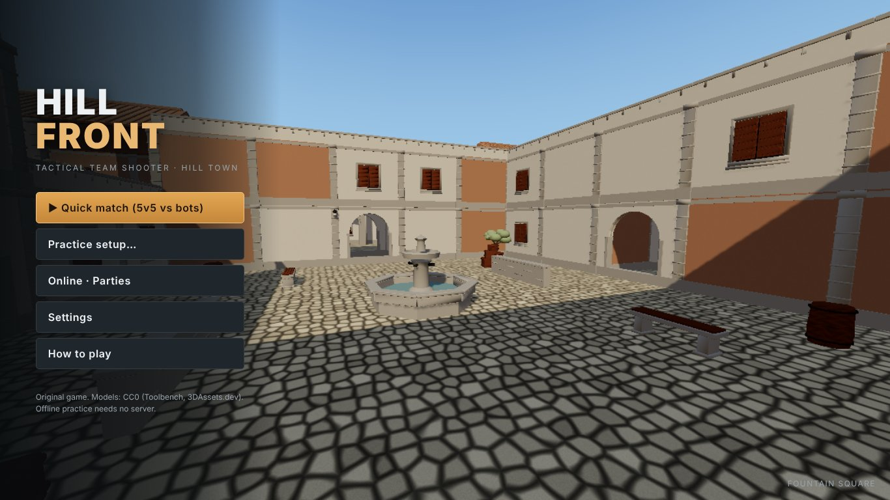
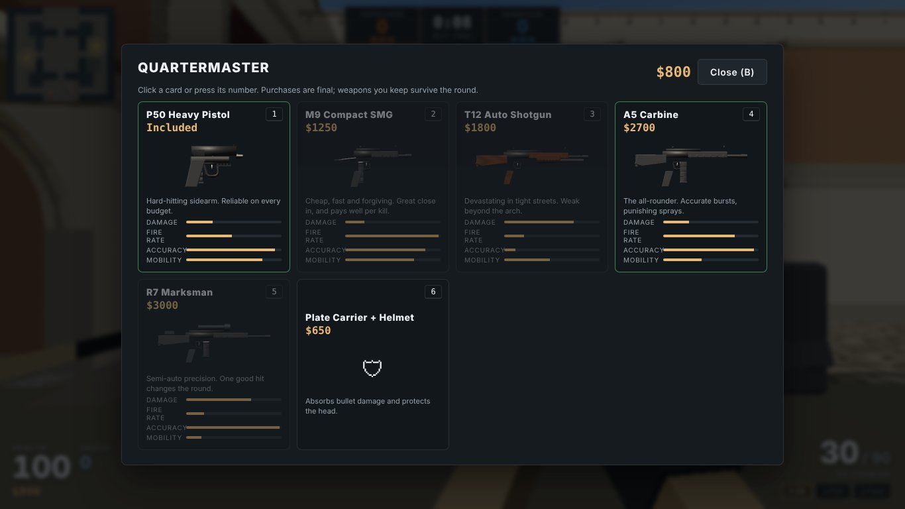
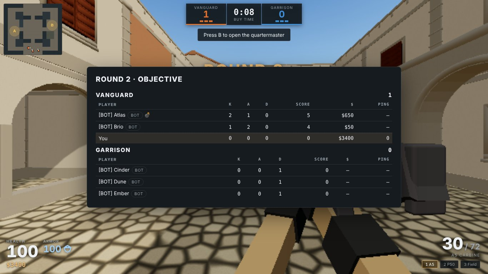
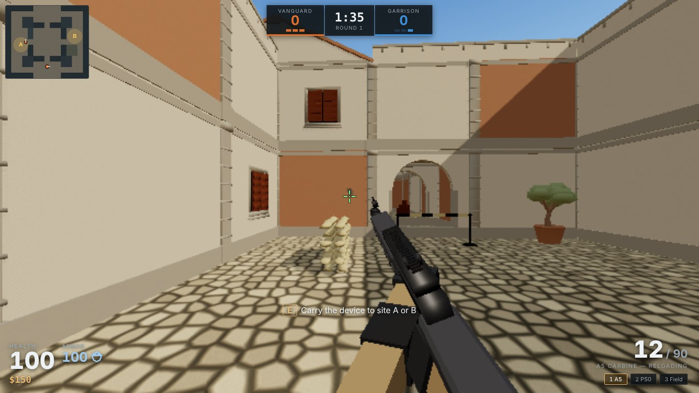
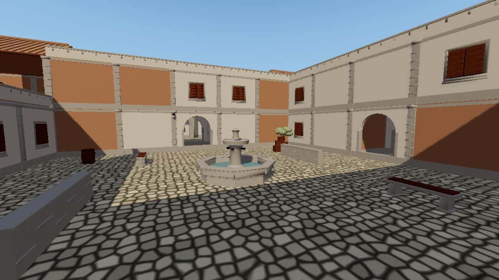
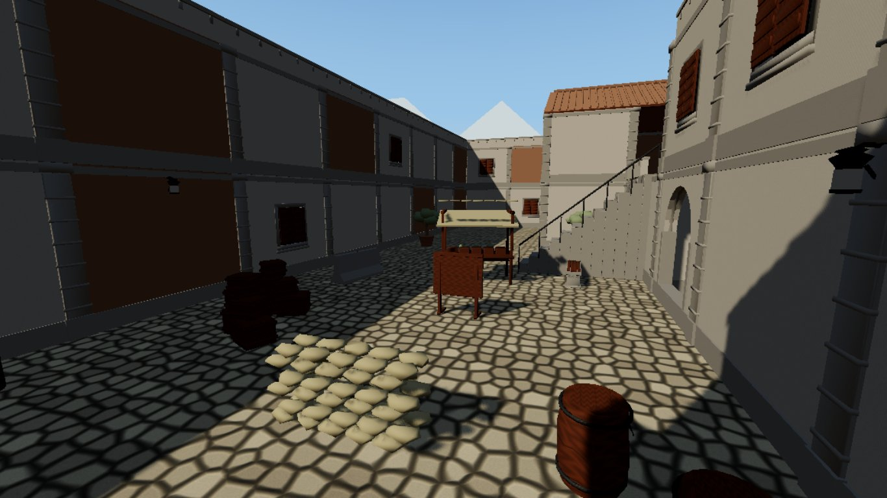
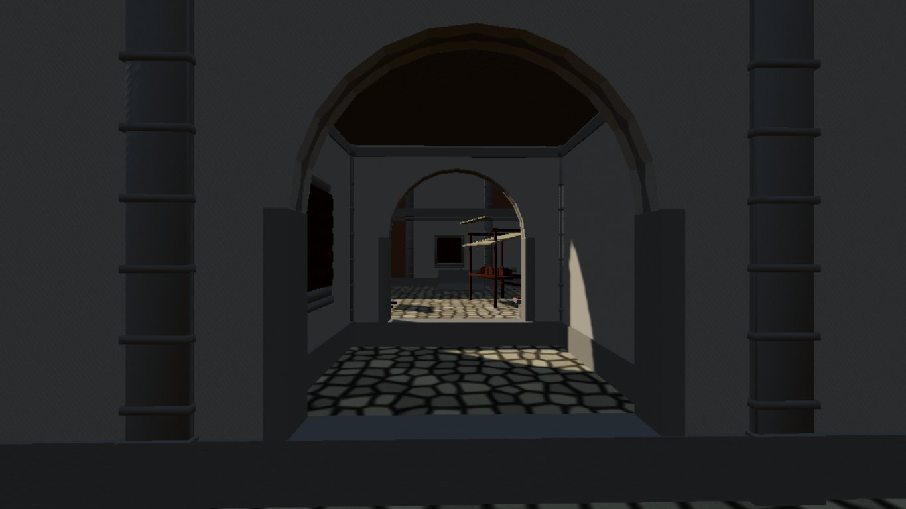
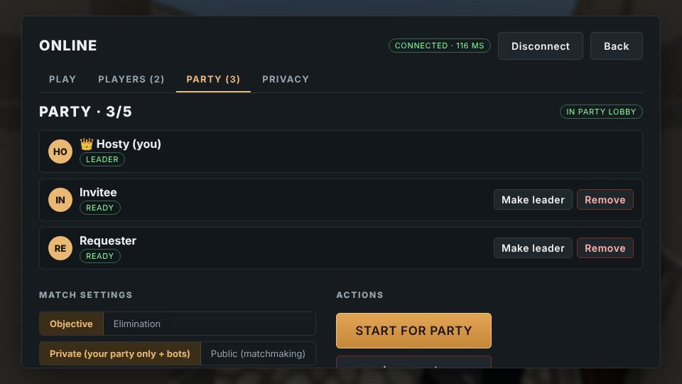
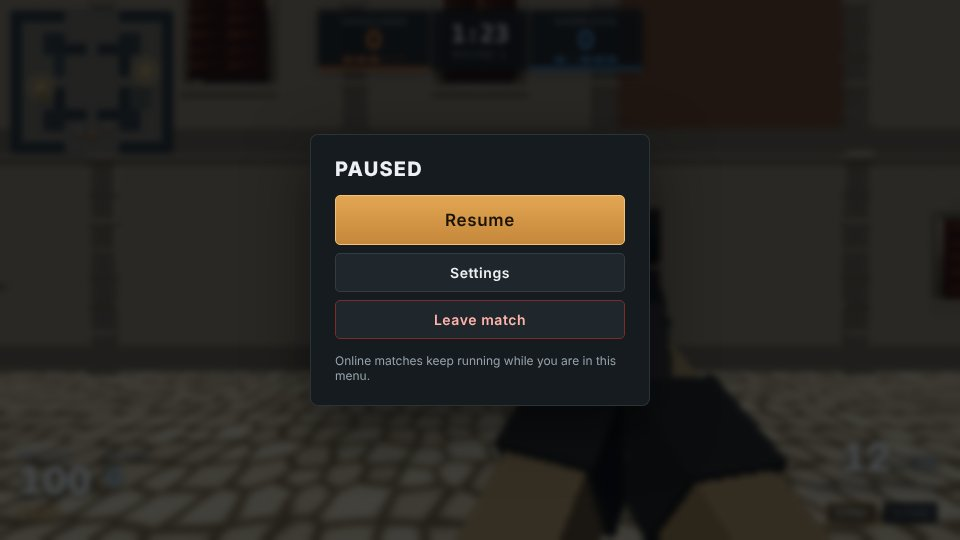
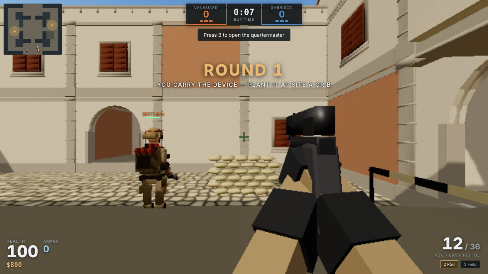

# Hillfront

An original, round-based, first-person **team tactical shooter** for the browser: two sides, a fictional hill-town map, a buy phase and economy, plant/disarm objective, bots for offline practice, and a real authoritative multiplayer server with Xbox-style **parties**.

Built with TypeScript + Three.js (client) and Node + `ws` (server). The release client is **one self-contained HTML file (2.4 MB)** that plays offline against bots.

> No Valve / Counter-Strike assets, names, logos, maps or audio are used. Models are CC0 (see [docs/ASSETS.md](docs/ASSETS.md)); all audio is synthesised in the browser.

---

## Run it

```bash
npm install
npm start            # game server (ws://localhost:8787/ws) + Vite client (http://localhost:5173)
```

Open **http://localhost:5173**. *Quick match* starts a 5v5 against bots with no server involved. To try parties, open the page in **two or three browser windows** (use a private window for the second guest), choose **Online · Parties** and **Connect** (server address is pre-filled).

| Command | What it does |
|---|---|
| `npm run dev` | client only (offline practice works without the server) |
| `npm run server` | server only (`PORT`, `ALLOWED_ORIGINS`, `MAX_SESSIONS` env vars) |
| `npm run release` | rebuild assets → build the single-file HTML → **size gate (fails over 12 MB)** |
| `npm run build:single` | single-file HTML only → `release/hillfront.html` (`-- --server wss://host/ws` bakes in your server) |
| `npm test` | 62+ unit/integration tests (sim, map, bots, assets, **real-WebSocket server tests**) |
| `npm run e2e:play` / `e2e:flows` / `e2e:net` | real-browser tests: gameplay input, menus/spectate/results/settings, **three browsers vs the real server** |
| `npm run assets:fetch` / `assets:build` | download + optimise the CC0 assets (`tools/asset-config.ts`) |
| `npm run assets:import` | inspect/optimise the CuiGames ZIPs you place in `assets/inbox/` |

Controls (rebindable): `WASD` move · mouse look/fire · `Space` jump · `C`/`Ctrl` crouch · `Shift` walk · `R` reload · `E` hold to plant/disarm · `B` buy menu · `Tab` scoreboard · `1 2 3` weapons · `F` inspect · `Esc` pause. Arrow keys always turn the camera (works where the browser refuses mouse capture); holding the right mouse button and dragging also looks around.

---

## Honest status

### Finished and verified (how)
| Area | Evidence |
|---|---|
| Soldier rig kept intact: 22 bones, 4 sockets, **all 53 actions** | `tests/assets.test.ts` reads the shipped GLB; build aborts if the rig changes |
| Soldier makeover (65 gear parts, shared atlas, 2 team palettes, 1 draw call) | before/after sheet `docs/evidence/soldier-before-after.jpg`; gear stays attached through run/crouch/fire/reload/death frames |
| Map: 4 m grid, two sites, tunnels, roof stair, hall, props, authored colliders | 13 map tests: every spawn reaches both sites, route lengths within 5 % across teams (35–37 m), simulated players walk the planned routes, stair climbs to the deck, walls hold, no stranded floor |
| Rules: rounds, economy, buy, armor, plant/disarm/detonate, half-time swap, match end | 20 deterministic sim tests |
| Bots (3 difficulties) | headless full-match tests; they navigate real collision, plant, defuse, buy |
| Offline client end to end | `e2e:play` (real keyboard/mouse: buy, move, jump, fire, reload completes, weapon switch, scoreboard, pause freezes the sim), `e2e:flows` (10 checks) |
| Server + parties | 16 tests with real WebSocket clients: presence privacy, invite/request/suggest, decline, duplicates, capacity, kick/promote/leave, leader hand-over, offline members, atomic launch into **one** match, party returns after a match and re-queues, public party queue keeps the party on one team, token reconnect, spoofed-input and flood resistance |
| **Three real browsers vs the real server** | `e2e:net`: 16 checks, incl. host movement visible in another browser and client prediction agreeing with the server |
| Single-file release | 2.40 MB; opens from `file://` with **all network blocked** and plays (`tools/releasetest.cjs`); gate script proven to fail when over budget |

### Needs something from you
1. **The CuiGames first-person weapons were NOT obtained.** Downloading them from itch.io was blocked by the sandbox permission system, so the first-person gun is a **provisional procedural viewmodel** (CC0 world models + animated arms). Download `A5_Base.zip` and `P50_Heavy_Pistol_Free.zip` yourself (links and licence notes in [assets/inbox/README.md](assets/inbox/README.md)) and run `npm run assets:import`. The importer inspects and optimises; **wiring a CuiGames GLB into the viewmodel is not done and untested** (it needs the real files).
2. **The server is not deployed publicly.** It runs locally and the tests pass; for internet play host `npm run server` behind TLS (see [docs/NETWORK.md](docs/NETWORK.md) and `render.yaml`) and bake the `wss://` address into the release with `--server`.

### Not verified (be sceptical of these)
- **Chromebook frame rate.** This build environment has no GPU. I measured *work per frame* (draw calls, triangles, texture memory — [docs/PERFORMANCE.md](docs/PERFORMANCE.md)) and reduced it ~50 %, but have **no real FPS numbers**. The 30/60 fps goals are targets, not results.
- **Real mouse-look direction and feel.** Headless Chromium reports bogus `movementX/Y` under pointer lock, so look sensitivity/direction was never tested with a physical mouse. The code follows the DOM standard.
- **Pointer lock inside a Google Sites embed.** Not testable here. If the frame blocks it the game falls back to arrow keys / right-mouse-drag (and says so).
- **Audio quality.** All sound is synthesised; I cannot listen to it. It runs without errors, nothing more is claimed.
- **Balance.** Bots on Normal currently favour Vanguard (5 of 6 rounds in one headless match); the economy and weapon numbers are first-pass.

### Not built
Grenades/smoke/flash (their models are in the kit but no gameplay), more than one map, spectator free-cam, persistent accounts (guests only, in-memory server), text/voice chat, touch controls, lag compensation beyond a capped position rewind, bot navigation onto the roof terrace.

---

## Evidence (real captures from this build, software WebGL)
| | |
|---|---|
|  **Main menu** over the live map |  **Quartermaster** (weapon cards rendered from the real models) |
|  **Scoreboard** with bots labelled |  **Reload** (provisional first-person weapon) |
|  **Fountain Square** |  **Site A** market and roof stair |
|  **West tunnel** |  **Party roster** (3 real browsers) |
|  **A second browser** watching the human host run |  **The 2.4 MB release file**, network blocked |

Soldier before/after: [docs/evidence/soldier-before-after.jpg](docs/evidence/soldier-before-after.jpg) · texture atlas: [docs/evidence/soldier-atlas.png](docs/evidence/soldier-atlas.png)

## Layout
```
src/engine     renderer, sky, quality presets, input, settings, effects
src/map        hillfront.ts (grid → placements + colliders), world.ts (collision), mapview.ts (chunked static meshes)
src/gameplay   sim.ts (authoritative rules, pure TS), movement.ts, weapons.ts, bots.ts, nav.ts, view.ts
src/character  soldier.ts (rig + upper/lower-body animation), atlas.ts, materials.ts
src/weapons    viewmodel.ts (PROVISIONAL first-person weapon)
src/network    protocol.ts (shared), client.ts
src/game       game.ts (presentation + loop), session.ts (LocalSession / NetSession with prediction)
src/ui         hud, screens (buy/scoreboard/pause/settings/results), menu, online (party UI)
src/audio      sfx.ts (WebAudio synthesis)
server/        hub, party, lobby (+matchmaking), match (authoritative runner), index
tools/         asset pipeline, soldier makeover, size gate, tests/QA drivers
tests/         vitest suites
docs/          ASSETS (generated), ANIMATIONS, NETWORK, PERFORMANCE, TESTING, SIZE_REPORT (generated)
```
The simulation (`src/gameplay`, `src/map`) is pure TypeScript with no DOM or three.js, so the **same code runs offline in the browser and authoritatively on the server**.

## Licences
Code: yours to license as you wish (no licence file added). CC0 assets: see [docs/ASSETS.md](docs/ASSETS.md). CuiGames files, if you add them, are *not* redistributable and are git-ignored.
